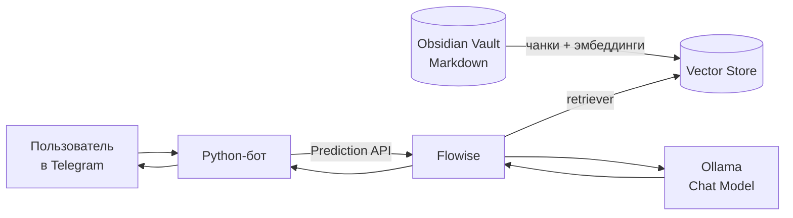

<div align="center">

# 🗂️ obsidian-rag-bot

**Telegram-бот, который отвечает на вопросы по твоим заметкам Obsidian.**

RAG-пайплайн собран в Flowise, модели крутятся локально в Ollama, Telegram-часть — на Python.


</div>

---

## Как это работает



Заметки Obsidian — база знаний. Flowise режет Markdown на чанки, строит эмбеддинги через Ollama Embeddings
и кладет их в векторное хранилище. На вопрос пользователя Flowise находит подходящие фрагменты и передает
их локальной LLM вместе с вопросом. Облачные API не нужны.

## Быстрый старт

<details open>
<summary><b>1. Модели в Ollama</b></summary>

Нужны две модели — для эмбеддингов и для ответов:

```bash
ollama pull nomic-embed-text
ollama pull qwen2.5:1.5b      # или любая instruct-модель покрупнее
```

</details>

<details open>
<summary><b>2. Flowise</b></summary>

```bash
cp .env.example .env
docker compose up -d
```

Интерфейс — `http://localhost:3000`, логин и пароль задаются `FLOWISE_USERNAME` / `FLOWISE_PASSWORD`.

Хранилище Obsidian монтируется в контейнер как `/vault`. Удобнее скопировать его в папку проекта:
с абсолютными путями Flowise работает капризно. Контейнер запущен с `network_mode: host`, поэтому Ollama
доступна из Flowise по `http://127.0.0.1:11434`.

</details>

<details open>
<summary><b>3. Chatflow</b></summary>

Собери в Flowise цепочку:

```text
Folder with Files → Markdown Text Splitter → Ollama Embeddings → Vector Store (FAISS)
                                                                        ↓
                         Ollama Chat Model ← Conversational Retrieval QA Chain
```

| Узел | Настройки |
|---|---|
| Folder with Files | Path `/vault`, Recursive, только `.md` |
| Markdown Text Splitter | Chunk size `500`, Overlap `80` |
| Ollama Embeddings | `http://127.0.0.1:11434`, `nomic-embed-text` |
| Ollama Chat Model | `http://127.0.0.1:11434`, например `qwen2.5:1.5b` |
| Vector Store | FAISS или встроенное хранилище Flowise |


Нажми **Upsert Vector Database** и проверь API:

```bash
curl -X POST "http://localhost:3000/api/v1/prediction/<chatflow_id>" \
  -H "Content-Type: application/json" \
  -d '{"question": "Что такое SQL injection?", "overrideConfig": {"sessionId": "test"}}'
```

</details>

<details open>
<summary><b>4. Бот</b></summary>

```bash
python3 -m venv .venv
source .venv/bin/activate          # Windows: .venv\Scripts\activate
pip install -r requirements.txt
python -m bot.main
```

`.env`:

```ini
TELEGRAM_TOKEN=token_from_botfather
TELEGRAM_PROXY_URL=                # например socks5h://127.0.0.1:10808

FLOWISE_URL=http://localhost:3000
FLOWISE_CHATFLOW_ID=change_me
FLOWISE_API_KEY=

BOT_ACCESS_PASSWORD=change_me
ALLOWED_TELEGRAM_USER_IDS=
REQUEST_TIMEOUT=180
```

`socks5h` пускает через прокси и DNS-запросы — удобно, если Telegram доступен только через VPN.

</details>

## Доступ и команды

Бот отвечает только своим: по allowlist Telegram ID (`ALLOWED_TELEGRAM_USER_IDS`) или после `/auth <пароль>`.
Авторизованные пользователи хранятся локально в `data/authorized_users.json` (в git не попадает).

| Команда | |
|---|---|
| `/start`, `/help` | приветствие и помощь |
| `/whoami` | показать свой Telegram ID |
| `/auth <пароль>` | получить доступ |
| `/logout` | удалить авторизацию |

Каждый пользователь получает свой `sessionId` (`telegram_<user_id>`): если в chatflow включена память,
история диалогов не смешивается.

## Структура

```text
bot/
├── main.py              хендлеры Telegram
├── flowise_client.py    запрос к Flowise Prediction API
├── auth.py              allowlist и пароль
├── formatters.py        разбиение длинных ответов
└── config.py            настройки из .env
docker-compose.yml       Flowise с примонтированным /vault
```

## Ограничения

- качество ответа упирается в локальную модель: маленькие модели отвечают проще и чаще промахиваются;
- после изменения заметок нужно снова сделать **Upsert Vector Database**;
- chatflow настраивается в интерфейсе Flowise и не хранится в коде целиком;
- если заметок мало, retriever может не найти хороший контекст.

## Куда развивать

- Dockerfile для бота и общий `docker compose` с Flowise;
- `/reset` для сброса истории и лог вопросов/ответов;
- автоматический переиндекс при изменении хранилища.

Этот бот стал основой для [telegram-persona-llm](https://github.com/k0zt3r/telegram-persona-llm) — бота,
который дообучен отвечать в стиле владельца аккаунта.

## Лицензия

[MIT](LICENSE)
